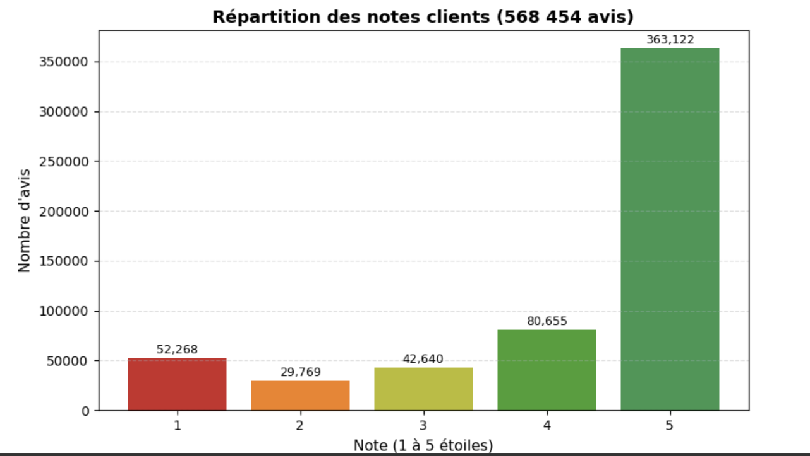
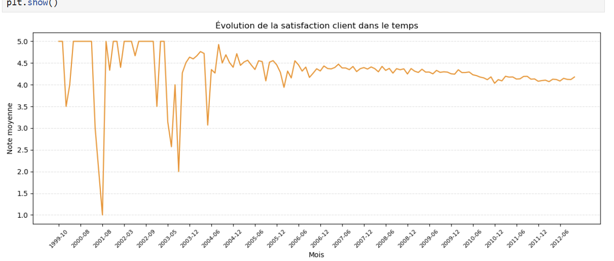

# Réputation client : analyse de 568 454 avis Amazon

Analyse des avis du jeu de données **Amazon Fine Food Reviews** : ce que disent les clients,
comment leur satisfaction évolue dans le temps, et pourquoi ils sont mécontents.



## Résultats

- **568 454 avis** analysés, notés de 1 à 5 étoiles : la grande majorité (363 122) donne 5 étoiles.
- **Classification du sentiment** (TF-IDF + régression logistique, avis neutres écartés,
  80 % entraînement / 20 % test) : **93,5 % de bonnes réponses** sur le jeu de test.
  Les avis négatifs, plus rares, sont les plus difficiles : rappel de 0,71 et F1 de 0,77.
- **5 sujets d'insatisfaction** repérés dans les 82 037 avis négatifs par topic modeling (LDA) :
  1. la commande et la livraison (colis, sachets, boîtes) ;
  2. le goût des boissons (café, thé, eau aromatisée) ;
  3. le prix des dosettes de café ;
  4. le goût des produits sucrés et salés (chocolat, biscuits, sel) ;
  5. la nourriture pour animaux, et sa provenance (Chine).
- **Évolution mensuelle** du nombre d'avis et de la note moyenne.



## Avancement

- [x] Choix du jeu de données et structure du projet
- [x] Chargement et nettoyage des textes (`avis-clients-projet/src/data_loader.py`)
- [x] Analyse exploratoire : répartition des notes, évolution dans le temps
- [x] Analyse de sentiment : TF-IDF et régression logistique
- [x] Topic modeling : LDA sur les avis négatifs
- [ ] Prévision de la satisfaction (séries temporelles)
- [ ] Tableau de bord de restitution

## Contenu du dépôt

```
Analyse_RLP_Prediction.ipynb      le notebook principal de l'analyse
avis-clients-projet/
  src/data_loader.py              chargement et nettoyage
  data/raw/sample_reviews.csv     petit échantillon pour tester
  outputs/                        graphiques produits
exercice-prix-voitures/           un exercice séparé (prédiction du prix de voitures d'occasion)
```

## Lancer l'analyse

```bash
pip install -r avis-clients-projet/requirements.txt
```

Téléchargez `Reviews.csv` sur Kaggle (https://www.kaggle.com/datasets/snap/amazon-fine-food-reviews),
placez-le dans `avis-clients-projet/data/raw/`, puis ouvrez `Analyse_RLP_Prediction.ipynb`.

## Outils

Python, Pandas, Matplotlib, Scikit-learn (TF-IDF, régression logistique, LDA).

---
Aly Keita · [Portfolio](https://aly-keita-portfolio.web.app) · [LinkedIn](https://www.linkedin.com/in/aly-keita-306703340/)
